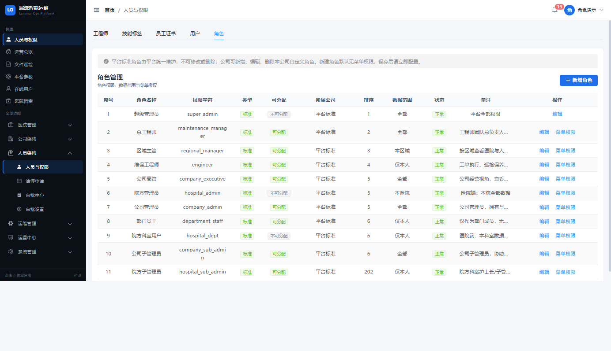
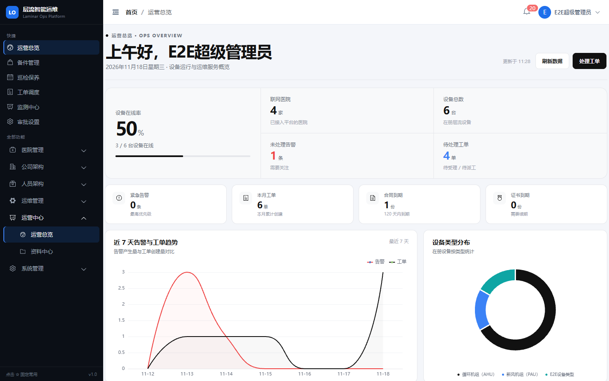
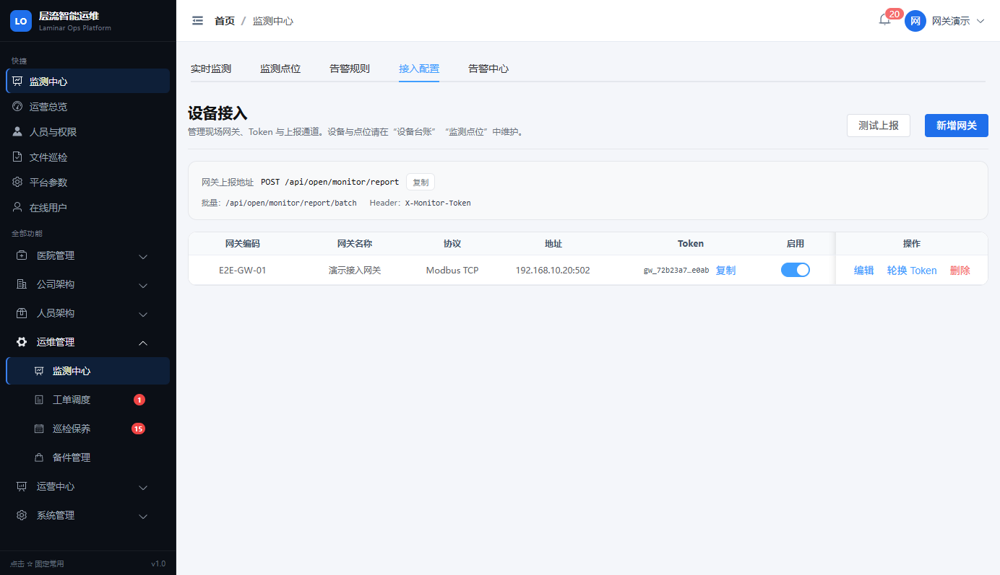
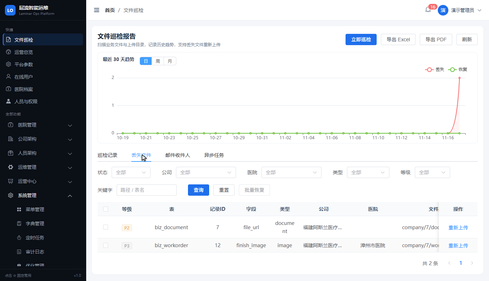
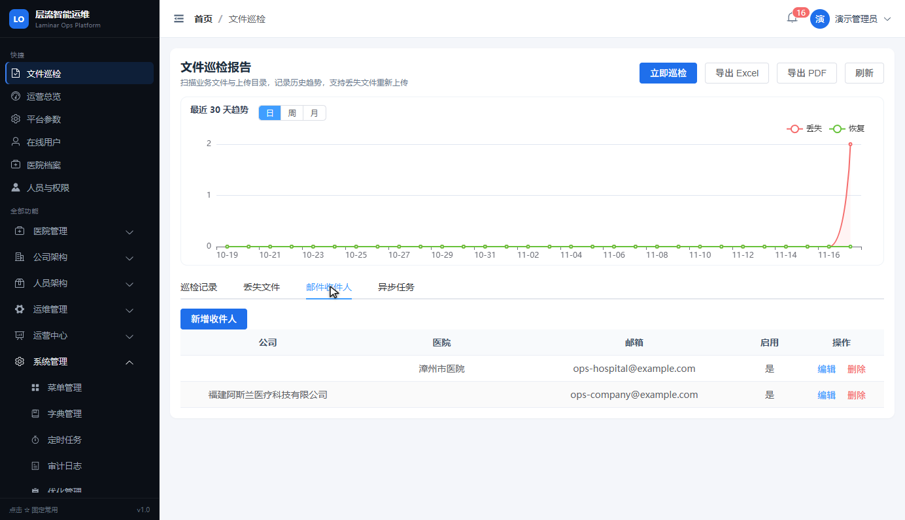
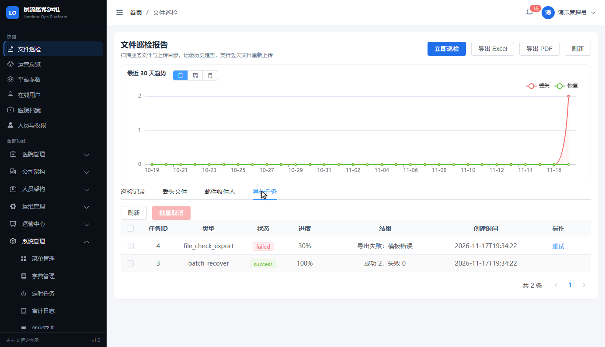

# 层流净化设备智能监测运维一体化平台

## 使用说明书

版本：V1.1  
更新日期：2026-11-18  
适用系统：运维后台 / 院方前台

---

## 文档说明

| 项目 | 内容 |
| --- | --- |
| 文档名称 | 层流净化设备智能监测运维一体化平台使用说明书 |
| 文档版本 | V1.1 |
| 适用对象 | 平台管理员、公司管理员、院方管理员、运维工程师、审计人员 |
| 系统组成 | Spring Boot 后端、Vue 3 运维后台、Vue 3 院方前台、MySQL、Redis |
| 默认后台入口 | `/app/login` |
| 默认院方入口 | `/portal/login` |
| 初始密码 | `Laminar@2026`，可在平台参数中修改 |

> 本说明书中的截图使用演示数据，实际页面数据以系统为准。

<!-- pagebreak -->

## 目录

1. 平台概览
2. 角色与权限
3. 登录、账号与密码
4. 运营总览
5. 客户与合同
6. 设备与监测
7. 告警管理
8. 工单管理
9. 巡检与保养
10. 人员、资质与备件
11. 文件巡检
12. 资料中心
13. 系统管理
14. 院方前台
15. 关键业务规则
16. 常见问题
17. 安全与运维建议

<!-- pagebreak -->

## 1. 平台概览

本平台面向医院洁净区域，包括手术室、ICU、静配中心、消毒供应中心、实验室等场景，围绕层流净化设备提供从档案、监测、告警、工单到巡检保养的一体化运维能力。

平台分为两端：

| 端 | 使用者 | 主要能力 |
| --- | --- | --- |
| 运维后台 | 平台方、维保公司 | 客户档案、设备监测、告警处置、工单调度、巡检保养、人员资质、备件、文件巡检、系统管理 |
| 院方前台 | 院方设备科、院感科、科室 | 查看本院设备与告警、提交报修、验收工单、接收消息 |

两端共用后端 API，数据按公司、医院、科室和角色范围隔离。

### 1.1 主要模块

```text
运营总览
客户管理：医院、院区、科室、对接人、合同
设备管理：设备类型、设备台账、监测点位、实时监测、告警规则
运维管理：告警中心、工单调度、巡检保养
资源管理：备件、资料中心、文件巡检
人员管理：工程师、技能、证书、请假、审批
系统管理：用户、角色、菜单、字典、定时任务、审计、参数、在线用户
院方前台：本院概览、设备、告警、报修、验收、消息
```

<!-- pagebreak -->

## 2. 角色与权限

### 2.1 账号范围

系统使用显式账号范围区分平台、公司和院方：

| 账号范围 | 说明 | 典型角色 |
| --- | --- | --- |
| 平台级 | 不归属具体公司或医院，负责平台运营 | 超级管理员、平台运营人员 |
| 公司级 | 归属某个维保公司 | 公司管理员、公司子管理员、工程师、公司员工 |
| 院方级 | 归属某家医院，可再绑定科室 | 院方管理员、院方子管理员、院方科室用户 |

### 2.2 账号创建边界

| 操作者 | 可创建的账号 |
| --- | --- |
| 平台超级管理员 | 平台、公司、院方全部类型 |
| 公司管理员 | 本公司公司员工、工程师 |
| 院方管理员 | 本院院方子管理员、院方科室用户 |
| 院方子管理员 | 不允许创建账号 |
| 院方科室用户 | 不允许创建账号 |

公司管理员不能创建院方账号；院方管理员不能创建院方管理员，也不能管理其他医院账号。

### 2.3 数据范围

| 角色 | 数据范围 |
| --- | --- |
| 平台超级管理员 | 全部数据 |
| 公司管理员 | 本公司数据 |
| 区域主管 | 所负责区域 |
| 工程师 | 本人工单与任务 |
| 院方管理员 | 本院数据 |
| 院方子管理员 | 本科室数据 |
| 院方科室用户 | 本科室数据 |



<!-- pagebreak -->

## 3. 登录、账号与密码

### 3.1 登录入口

| 端 | 地址 |
| --- | --- |
| 运维后台 | `http://服务器地址/app/login` |
| 院方前台 | `http://服务器地址/portal/login` |

登录字段：

```text
公司编码：公司账号填写；平台管理员可留空
账号：用户名、手机号或邮箱
密码：登录密码
验证码：系统开启图形验证码时填写
```

### 3.2 初始密码

系统新建账号和管理员重置密码时使用平台参数中的初始密码：

```text
默认值：Laminar@2026
配置项：sys.user.initPassword
配置位置：平台参数 → 账号安全 → 用户管理-账号初始密码
```

首次登录或密码被重置后，系统会要求修改密码。

### 3.3 忘记密码

当前版本不提供登录页自助找回密码，处理方式如下：

| 用户类型 | 处理人 | 操作 |
| --- | --- | --- |
| 公司员工、工程师 | 公司管理员 | 用户与权限 → 用户 → 重置密码 |
| 院方子管理员、院方科室用户 | 本院院方管理员或平台管理员 | 用户与权限 → 用户 → 重置密码 |
| 公司管理员 | 平台超级管理员 | 重置密码 |
| 院方管理员 | 平台超级管理员 | 重置密码 |
| 平台超级管理员 | 服务器管理员 | 执行受控的紧急重置流程 |

重置后：

```text
密码恢复为初始密码
清除登录失败次数和锁定状态
下次登录强制修改密码
```

### 3.4 修改密码

登录后点击右上角用户菜单：

```text
个人设置 → 修改密码 → 输入旧密码和新密码
```

密码规则由平台参数控制，生产环境建议不少于 8 位，并包含字母、数字和符号。

<!-- pagebreak -->

## 4. 运营总览

运营总览是登录后的首页，用于快速了解设备、告警、工单和合同状态。



页面包含：

| 区域 | 内容 |
| --- | --- |
| 设备在线率 | 在线设备数 / 设备总数，进度条展示 |
| 运营指标 | 联网医院、设备总数、未处理告警、待处理工单 |
| 关注指标 | 紧急告警、本月工单、合同到期、证书到期 |
| 趋势图 | 近 7 天告警与工单数量 |
| 类型分布 | 在册设备按设备类型统计 |
| 最新告警 | 按时间倒序展示，支持跳转告警列表 |
| 医院在线情况 | 按医院统计在线设备数 / 总数 |
| 合同提醒 | 120 天内到期合同 |
| 今日待办 | 当日巡检、保养任务 |

右上角支持：

```text
刷新数据：重新加载运营数据
处理工单：跳转工单调度
```

运营总览中的数字和图表会随业务数据实时变化。

<!-- pagebreak -->

## 5. 客户与合同

### 5.1 医院档案

进入：

```text
医院管理 → 医院档案
```

支持：

```text
新增医院、编辑医院、查看详情
维护医院名称、编码、等级、类型、区域、联系人、电话
维护合作公司、院区、科室、设备台账
```

顶部标签页可切换：

```text
医院 / 院区 / 科室 / 对接人 / 设备台账 / 设备类型
```

删除医院前应确认没有关联院区、设备、工单和合同。

### 5.2 公司与合同

进入：

```text
公司架构 → 公司与合同
```

包含：

```text
公司信息：公司名称、编码、负责人、联系方式
合同管理：合同编号、医院、起止日期、金额、负责人、预警天数
```

合同到期前，系统会根据预警天数产生提醒。

### 5.3 组织架构

进入：

```text
公司架构 → 组织架构
```

维护公司部门树、岗位和人员归属。

<!-- pagebreak -->

## 6. 设备与监测

### 6.1 设备类型

维护层流机组、净化空调、新风、除湿、供氧汇流排、负压真空等设备类型。

### 6.2 设备台账

进入：

```text
医院管理 → 设备台账
```

维护：

```text
设备名称、设备编码、医院、院区、科室、洁净区域
设备类型、型号、序列号、安装日期
通信协议、地址、在线状态、运行状态
```

### 6.3 监测点位

进入：

```text
运维管理 → 监测中心 → 监测点位
```

每个设备可以维护多个点位：

```text
温度、湿度、压差、风速、粒子、氧气压力、真空度、运行状态
```

点位包含：

```text
点位编码、点位名称、监测指标、单位
预警下限/上限、告警下限/上限
采集周期、启用状态
```

### 6.4 实时监测

进入：

```text
运维管理 → 监测中心 → 实时监测
```

页面展示设备卡片和最新点位值，点击设备可查看：

```text
当前点位值
24 小时曲线
设备状态
最近告警
```

### 6.5 告警规则

进入：

```text
运维管理 → 监测中心 → 告警规则
```

规则支持：

```text
按设备、设备类型或全局配置
选择监测指标和比较符
设置阈值、持续时长和告警级别
配置是否自动转工单
```

### 6.6 真实设备接入

平台本身不直接连接 Modbus、BACnet、OPC UA 等工业协议，现场需要一个**边缘网关**完成协议采集，再通过 HTTP 上报平台。



#### 第一步：在平台建档

```text
1. 维护设备类型
2. 新增设备台账，填写唯一设备编号，例如 AHU-04
3. 在设备台账选择“接入网关”
4. 为设备新增监测点位，填写点位名称、指标、单位、告警上下限
5. 记录平台生成的设备编号和点位编码，例如 AHU-04-TEMP
6. 将设备的“模拟采集”关闭，避免模拟数据覆盖真实数据
```

#### 第二步：在界面登记网关

进入：

```text
运维管理 → 监测中心 → 接入配置
→ 新增网关
```

填写：

```text
网关编码：例如 GW-AHU-01
网关名称：例如 住院楼 3F 网关
协议：Modbus TCP / Modbus RTU / BACnet / OPC UA / MQTT
网关地址：例如 192.168.10.20:502
IP 白名单：例如 192.168.10.20,192.168.10.*；留空不限制
备注
```

保存后平台会自动生成网关 Token。复制 Token 配置到现场网关，不要使用管理员密码。

如果旧网关 Token 泄露，在「接入配置」中点击「轮换 Token」，旧 Token 会立即失效。点击「审计」可查看 Token 生成和轮换记录，只记录 Token 后 8 位。

#### 第三步：网关上报

单点上报，可选 `timestamp`：

```http
POST /api/open/monitor/report
X-Monitor-Token: 现场网关专用Token
Content-Type: application/json

{"equipmentCode":"AHU-04","pointCode":"AHU-04-TEMP","value":23.6,"timestamp":"2026-11-18 10:00:00"}
```

批量上报：

```http
POST /api/open/monitor/report/batch
X-Monitor-Token: 现场网关专用Token
Content-Type: application/json

[
  {"equipmentCode":"AHU-04","pointCode":"AHU-04-TEMP","value":23.6,"timestamp":"2026-11-18 10:00:00"},
  {"equipmentCode":"AHU-04","pointCode":"AHU-04-HUMI","value":52.1},
  {"equipmentCode":"BAD","pointCode":"BAD","value":1}
]
```

平台返回逐点明细：

```json
{
  "code": 200,
  "data": {
    "count": 2,
    "success": 2,
    "failed": 1,
    "items": [
      {"equipmentCode":"AHU-04","pointCode":"AHU-04-TEMP","success":true,"count":1},
      {"equipmentCode":"AHU-04","pointCode":"AHU-04-HUMI","success":true,"count":1},
      {"equipmentCode":"BAD","pointCode":"BAD","success":false,"message":"设备或点位不存在：BAD/BAD"}
    ]
  }
}
```

`timestamp` 用于断网补传。平台写入历史数据；超过 5 分钟的补传数据不会覆盖实时最新值，也不会触发实时告警。

在「接入配置 → 测试上报」中，可以直接从下拉框选择设备和监测点位，填写测试值后发送，不需要手工输入编码。

设备下拉只列出已维护并启用监测点位的设备；选择设备后会联动加载点位。选择点位后，界面会显示告警/预警上下限，并根据测试值提示：

```text
正常范围
超出预警范围
超出告警范围
未配置阈值
```

测试记录会保留最近 10 次，包括设备、点位、测试值、结果、是否触发告警、失败原因和操作人，并支持按设备、结果和时间筛选。测试失败时会返回具体原因，例如设备或点位不存在、Token 无效、数值格式错误。

选择点位后还会显示点位最近一次真实值。规则预览会同时判断点位阈值和告警规则，不写入数据、不触发告警。

测试记录默认保留 90 天，由后台每日清理；可通过 `laminar.monitor.test-log-retain-days` 调整。

平台对温度、湿度、压差、风速、粒子、氧气压力、真空做基础范围校验，明显越界的数据会拒绝写入，避免污染曲线和告警。设备连续超时由离线检测规则处理；更细的跳变过滤和按网关的数据质量策略属于下一阶段能力。

#### 第四步：现场网络

```text
网关需要能访问后端地址和端口
生产环境建议通过 HTTPS + Nginx 反向代理 /api/open/
只开放必要路径，不要暴露整个内网
网关与服务器保持时间同步
```

#### 数据写入后的效果

```text
实时监测页面出现最新值
写入 biz_monitor_data 历史曲线
更新设备最后心跳和在线状态
按点位阈值/告警规则产生告警
恢复上报后自动关闭离线告警
```

#### 注意事项

```text
设备编号和点位编码必须与平台一致，否则返回“设备不存在”
value 必须是数字
单次批量最多 500 个点位
平台当前使用服务器接收时间，不接收网关历史时间戳
```

<!-- pagebreak -->

## 7. 告警管理

进入：

```text
运维管理 → 告警中心
```

### 7.1 告警状态

```text
0 未确认
1 已确认
2 处理中
3 已消缺
4 已忽略
```

### 7.2 告警操作

| 操作 | 说明 |
| --- | --- |
| 确认 | 值班人员确认告警 |
| 处理 | 开始现场处理 |
| 消缺 | 填写根本原因和处理措施 |
| 忽略 | 填写忽略原因 |
| 追溯 | 查看处理时间线和操作人 |
| 转工单 | 生成维修工单并回写告警 |

同一设备点位在未消缺期间会合并告警，持续更新最近发生时间和持续时长。

### 7.3 告警推送

告警生成、升级和消缺时，系统可推送站内消息；配置邮件后，文件巡检和告警通知可发送邮件。

<!-- pagebreak -->

## 8. 工单管理

进入：

```text
运维管理 → 工单调度
```

### 8.1 工单状态

| 状态 | 含义 | 主要操作 |
| --- | --- | --- |
| 0 | 待受理 | 受理、取消 |
| 1 | 待派工 | 派工、取消 |
| 2 | 处理中 | 到场、完工、报价 |
| 3 | 待验收 | 院方验收通过/驳回 |
| 4 | 待回访 | 回访 |
| 5 | 已完成 | 查看 |
| 6 | 已取消 | 查看 |

### 8.2 标准流程

```text
院方报修或告警转工单
→ 平台/公司受理
→ 派工给工程师
→ 工程师到场
→ 填写处理结果并完工
→ 院方验收
→ 平台回访
→ 工单完成
```

### 8.3 派工

派工时可选择工程师，系统会按照：

```text
医院、技能、区域、在岗状态、当前负载、证书有效期
```

进行智能推荐，也支持手工指定。

### 8.4 验收

院方在待验收状态下可以：

```text
验收通过：进入待回访
验收驳回：退回处理中
```

驳回时应填写原因，工程师需要重新处理。

<!-- pagebreak -->

## 9. 巡检与保养

### 9.1 巡检计划

进入：

```text
运维管理 → 巡检保养 → 巡检计划
```

维护：

```text
计划名称、医院、设备、执行人
执行周期、开始日期、检查项模板
```

系统按计划生成巡检任务，逾期任务自动标记。

### 9.2 巡检任务

任务状态：

```text
0 待执行
1 执行中
2 已完成
3 已逾期
4 已取消
```

执行时逐项填写：

```text
检查结果、实测值、备注、现场照片
```

整体异常可一键转维修工单。

### 9.3 保养计划与任务

保养计划维护：

```text
设备、保养级别、周期、保养内容、执行人
```

保养任务执行时填写保养记录，并可登记使用备件。

<!-- pagebreak -->

## 10. 人员、资质与备件

### 10.1 人员与权限

进入：

```text
人员与权限
```

包含：

```text
工程师：姓名、电话、职称、专业、区域、在岗状态
技能标签：层流机组、净化空调、新风、除湿、电气、检测等
员工证书：证书编号、发证机构、有效期、提醒天数
用户：账号、角色、部门、岗位、状态
角色：角色名称、权限字符、数据范围、菜单授权、可分配状态
```

### 10.2 角色管理

标准角色由平台维护，不能删除，权限字符不能修改。

角色列表支持：

```text
按可分配 / 不可分配筛选
查看分配记录
配置菜单权限
```

角色分配记录记录：

```text
分配、移除、创建、修改、删除
操作人、目标用户、时间
```

### 10.3 证书提醒

系统根据证书有效期计算：

```text
有效
即将到期
已过期
```

到期前按提醒天数推送消息。

### 10.4 备件管理

进入：

```text
资源管理 → 备件管理
```

维护：

```text
备件编码、名称、类别、规格、单位
安全库存、当前库存、单价、供应商、库位
```

领用流程：

```text
申请 → 批准/驳回 → 出库 → 扣减库存并写流水
```

<!-- pagebreak -->

## 11. 文件巡检

文件巡检用于扫描业务表中的文件字段，发现文件丢失、路径异常和无法访问的文件，并支持通知与恢复。

进入：

```text
系统管理 → 文件巡检
```



### 11.1 执行巡检

点击「立即巡检」，系统会：

```text
扫描配置的业务表和文件字段
检查文件是否存在、是否可读
生成巡检批次和丢失文件记录
按文件类型计算 SLA
```

页面顶部展示最近 30 天趋势，支持日、周、月切换。

### 11.2 丢失文件

筛选条件：

```text
状态、公司、医院、类型、等级、关键字
```

列表字段：

```text
严重等级、表、记录 ID、字段、类型、公司、医院、文件、操作
```

支持：

```text
单条重新上传
勾选后批量恢复
导出 Excel / PDF
```

### 11.3 邮件收件人

进入「邮件收件人」标签：

```text
按公司配置收件人
按医院配置收件人
启用/停用
编辑、删除
```



### 11.4 异步任务

进入「异步任务」标签：

```text
查看任务类型、状态、进度、结果、创建时间
批量取消
失败任务重试
下载导出文件
```



### 11.5 SLA 升级

系统按严重等级进行多级 SLA 升级，超时后通知平台和相关负责人。

<!-- pagebreak -->

## 12. 资料中心

进入：

```text
运营中心 → 资料中心
```

维护：

```text
图纸、说明书、检测报告、培训资料
文档名称、分类、所属公司、版本、文件
```

支持文件上传、下载、预览和按公司/分类查询。

知识库用于维护：

```text
故障案例、操作规程、应急预案、培训资料
```

<!-- pagebreak -->

## 13. 系统管理

### 13.1 用户管理

进入：

```text
系统管理 → 用户管理
```

支持：

```text
新增员工
分配部门、岗位、角色
绑定工程师
重置密码
启用/停用
删除
```

新增账号时会根据账号类型自动带出角色：

```text
公司员工
工程师
院方管理员
院方子管理员
院方科室用户
```

### 13.2 菜单与字典

菜单管理用于查看菜单、按钮和权限标识；字典管理用于维护数据字典类型和字典值。

### 13.3 定时任务

进入：

```text
系统管理 → 定时任务
```

可查看和启停：

```text
监测采集
设备离线检测
巡检任务生成
保养任务生成
合同/证书提醒
文件巡检
SLA 升级
日志归档
```

### 13.4 审计日志

系统自动记录：

```text
登录日志
操作审计
角色分配记录
配置修改日志
```

### 13.5 平台参数

维护：

```text
平台名称、Logo、客服信息
账号安全：初始密码、密码最小长度、验证码开关
邮件配置
文件上传限制
文件巡检参数
```

### 13.6 在线用户与监控

在线用户查看当前登录会话；系统监控查看 JVM、Redis、数据库和运行状态。

### 13.7 优化管理与数据归档

优化管理记录平台改进事项；数据归档按策略归档历史业务数据，归档前应确认备份。

<!-- pagebreak -->

## 14. 院方前台

院方账号登录：

```text
http://服务器地址/portal/login
```

院方前台提供：

| 页面 | 操作 |
| --- | --- |
| 本院概览 | 设备数、在线率、未处理告警、待办工单、合同到期 |
| 设备监测 | 本院设备实时值和点位详情 |
| 设备告警 | 查看本院告警和处理时间线 |
| 报修工单 | 提交报修、跟踪进度、验收通过/驳回 |
| 消息通知 | 查看告警、工单、合同提醒 |

院方端不能访问后台的设备档案、人员、预算和系统管理功能。

院方管理员可以创建：

```text
本院院方子管理员
本院院方科室用户
```

不能创建院方管理员，也不能操作其他医院账号。

<!-- pagebreak -->

## 15. 关键业务规则

| 规则 | 说明 |
| --- | --- |
| 数据隔离 | 公司按 company_id，院方按 hospital_id，科室用户按 department_id |
| 工单 SLA | P0 2 小时、P1 8 小时、P2 24 小时，具体以配置为准 |
| 告警合并 | 同设备点位未消缺期间合并 |
| 告警消缺 | 需填写根本原因和处理措施 |
| 密码重置 | 重置为初始密码，强制下次修改 |
| 角色删除 | 标准角色不可删除 |
| 角色分配 | 只有“可分配”角色才能被分配 |
| 院方账号 | 公司管理员不能创建，由平台或院方管理员创建 |
| 文件巡检 | 按严重等级执行 SLA 升级 |
| 数据归档 | 归档前必须完成备份 |

<!-- pagebreak -->

## 16. 常见问题

| 现象 | 处理 |
| --- | --- |
| 登录提示账号或密码错误 | 检查公司编码、账号和密码；忘记密码联系管理员重置 |
| 登录后没有菜单 | 检查角色菜单授权和账号状态 |
| 页面 404 | 确认访问 `/app/login` 或 `/portal/login` |
| Redis 连接失败 | 检查 Redis 服务和连接配置 |
| 文件上传失败 | 检查文件大小、类型和上传目录权限 |
| 文件巡检全部丢失 | 检查上传目录路径和文件挂载 |
| 院方看不到数据 | 检查院方医院/科室绑定和用户状态 |
| 工单无法验收 | 确认工单已进入待验收状态 |
| 标准角色无法删除 | 标准角色受保护，属于正常行为 |
| 密码修改失败 | 检查新密码长度和复杂度要求 |

<!-- pagebreak -->

## 17. 安全与运维建议

### 17.1 上线前检查

```text
修改 JWT_SECRET，长度不少于 32 字节
修改 CONFIG_SECRET 和 FILE_SIGN_SECRET
修改数据库默认密码
关闭演示数据
关闭或替换模拟采集任务
配置 HTTPS
配置备份和日志轮转
```

### 17.2 备份

至少备份：

```text
MySQL 数据库
上传文件目录
平台配置
```

建议每日自动备份，并定期做恢复演练。

### 17.3 日志与监控

系统提供：

```text
/actuator/health
/actuator/metrics
/actuator/prometheus
```

建议接入 Prometheus 和告警系统，监控：

```text
服务健康
接口错误率
数据库连接池
Redis 状态
文件巡检任务
异步任务失败率
```

### 17.4 Docker 部署

项目根目录提供：

```text
Dockerfile
docker-compose.yml
```

启动前设置必要的环境变量：

```text
JWT_SECRET
CONFIG_SECRET
FILE_SIGN_SECRET
MYSQL_ROOT_PASSWORD
MYSQL_PASSWORD
```

---

## 附录 A：文档维护

| 项目 | 说明 |
| --- | --- |
| 维护人 | 平台研发/运维团队 |
| 更新频率 | 功能变更、权限变更、部署方式变更时更新 |
| 关联文档 | `README.md`、`docs/testing.md`、`docs/database-migration.md` |
| 反馈方式 | 提交到项目 Issue 或由平台管理员登记优化事项 |

## 附录 B：版本记录

| 版本 | 日期 | 说明 |
| --- | --- | --- |
| V1.1 | 2026-11-18 | 更新运营总览、院方账号边界、角色管理、文件巡检与部署说明 |
| V1.0 | 2026-10-29 | 初版使用说明 |
